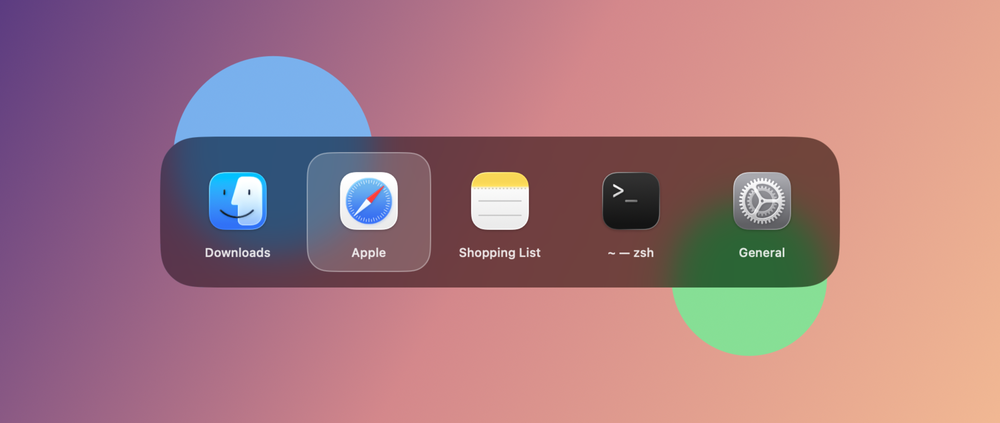

# WindowSwitcher.spoon

Windows-style Alt+Tab for macOS, as a [Hammerspoon](https://www.hammerspoon.org) Spoon.
**Cmd+Tab switches between windows, not apps**, on a native Liquid Glass panel.



- Two windows of the same app are separate entries, so you can jump straight to the one you want.
- Most recently used first: a quick Cmd+Tab tap goes back to the previous window without showing the panel.
- The panel is a real `NSGlassEffectView` (macOS 26 Liquid Glass), not an imitation.
- Fast: no window thumbnails; the panel is drawn by a small native helper that stays running (~8 MB).

## Keys

| Key | Action |
| --- | --- |
| Cmd+Tab | Next window (first press selects the previously used window) |
| Cmd+Shift+Tab | Previous window |
| Release Cmd | Switch to the selected window |
| Esc | Cancel |

Only windows on the current Space are listed.

## Requirements

- macOS 26 or later
- [Hammerspoon](https://www.hammerspoon.org), with Accessibility permission
- Xcode Command Line Tools (`xcode-select --install`), used to compile the panel helper

## Install

```sh
git clone https://github.com/ZachariahJ/WindowSwitcher.spoon ~/.hammerspoon/Spoons/WindowSwitcher.spoon
```

Then add to `~/.hammerspoon/init.lua` and reload:

```lua
hs.loadSpoon("WindowSwitcher")
spoon.WindowSwitcher:start()
```

The first start compiles the panel helper, which freezes Hammerspoon for a few seconds.
To update, `git pull` in that folder and reload; it recompiles only if `glass.swift` changed.

## Configuration

```lua
hs.loadSpoon("WindowSwitcher")
spoon.WindowSwitcher.delay = 0   -- show the panel immediately (default 0.12 s)
spoon.WindowSwitcher:start()
```

`spoon.WindowSwitcher:stop()` gives you the system Cmd+Tab back.

More tweaks are documented as comments in the source, with examples:
Alt+Tab instead of Cmd+Tab, arrow keys, all Spaces, hiding apps (`init.lua`);
clear or tinted glass, sizes, panel position (`glass.swift`).

## How it works

- `init.lua` does the logic. macOS reserves Cmd+Tab, so it is caught with an `hs.eventtap`.
  Windows come from `hs.window.filter`, sorted by most recent use, and releasing Cmd focuses the selected one.
- `glass.swift` only draws the panel. Hammerspoon can't create Liquid Glass itself, so this small AppKit program does it.
  It's compiled to `glass` on first start, runs in the background, and gets one JSON command per line on stdin
  (`show`, `select`, `hide`). It exits when Hammerspoon reloads or quits.

## License

MIT
