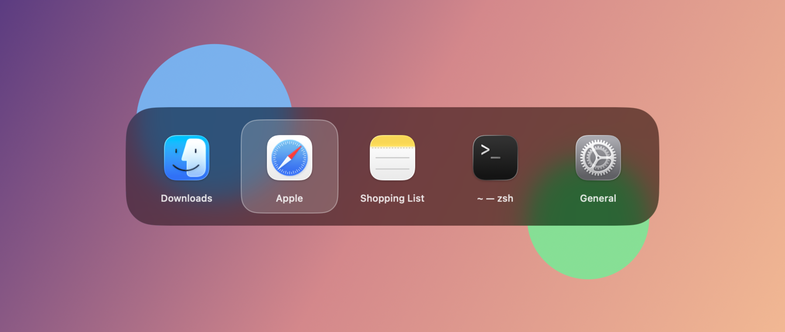

# WindowSwitcher.spoon

[English](README.md) | 简体中文

在 macOS 上实现 Windows 式的 Alt+Tab，做成一个 [Hammerspoon](https://www.hammerspoon.org) Spoon。
**Cmd+Tab 按窗口切换，而不是按应用**，面板是原生的 Liquid Glass 效果。



- 同一个应用的多个窗口各占一格，可以直接跳到想要的那个。
- 按最近使用排序：快速按一下 Cmd+Tab 就回到上一个窗口，不弹面板。
- 面板用的是系统真正的 `NSGlassEffectView`（macOS 26 的 Liquid Glass），不是模仿出来的。
- 快：不截窗口缩略图；面板由一个常驻后台的小程序绘制（约 8 MB 内存）。

## 按键

| 按键 | 作用 |
| --- | --- |
| Cmd+Tab | 下一个窗口（第一次按选中上一个用过的窗口） |
| Cmd+Shift+Tab | 上一个窗口 |
| 松开 Cmd | 切到选中的窗口 |
| Esc | 取消 |

只列出当前桌面（Space）上的窗口。

## 系统要求

- macOS 26 或更高版本
- [Hammerspoon](https://www.hammerspoon.org)，并授予辅助功能权限
- Xcode Command Line Tools（`xcode-select --install`），用来编译面板小程序

## 安装

**用 [SpoonInstall](https://www.hammerspoon.org/Spoons/SpoonInstall.html)**：在 `~/.hammerspoon/init.lua` 里加上下面几行，再重载 Hammerspoon：

```lua
hs.loadSpoon("SpoonInstall")
spoon.SpoonInstall.repos.WindowSwitcher = {
  url = "https://github.com/ZachariahJ/WindowSwitcher.spoon",
  desc = "WindowSwitcher.spoon",
  branch = "main",
}
spoon.SpoonInstall:andUse("WindowSwitcher", { repo = "WindowSwitcher", start = true })
```

**用 git**

```sh
git clone https://github.com/ZachariahJ/WindowSwitcher.spoon ~/.hammerspoon/Spoons/WindowSwitcher.spoon
```

然后在 `~/.hammerspoon/init.lua` 里加上下面两行，再重载 Hammerspoon：

```lua
hs.loadSpoon("WindowSwitcher")
spoon.WindowSwitcher:start()
```

更新时在这个文件夹里运行 `git pull`，再重载即可。

两种方式第一次启动时都会编译面板小程序，Hammerspoon 会卡住几秒。
只有 `glass.swift` 变了才会重新编译。

## 配置

```lua
hs.loadSpoon("WindowSwitcher")
spoon.WindowSwitcher.delay = 0   -- 一按就弹出面板（默认 0.12 秒）
spoon.WindowSwitcher:start()
```

运行 `spoon.WindowSwitcher:stop()` 可以换回系统自带的 Cmd+Tab。

源码注释里有更多改法和示例：
改成 Alt+Tab、用方向键移动、列出所有桌面的窗口、排除某个应用（见 `init.lua`）；
更通透或带颜色的玻璃、尺寸、面板位置（见 `glass.swift`）。

## 原理

- `init.lua` 负责所有逻辑。macOS 占用了 Cmd+Tab，所以用 `hs.eventtap` 拦截。
  窗口列表来自 `hs.window.filter`，按最近使用排序，松开 Cmd 时聚焦选中的窗口。
- `glass.swift` 只负责显示面板。Hammerspoon 自己画不出 Liquid Glass，所以用这个 AppKit 小程序来画。
  它在第一次启动时被编译成 `glass`，常驻后台，从标准输入每行接收一条 JSON 命令（`show`、`select`、`hide`）。
  Hammerspoon 重载或退出时它会自动退出。

## 开发

改完 Spoon 之后、提交之前，运行一次 `./build.sh`。它会重新生成 SpoonInstall 要下载的
`docs/docs.json` 和 `Spoons/WindowSwitcher.spoon.zip`。

## 许可证

MIT
